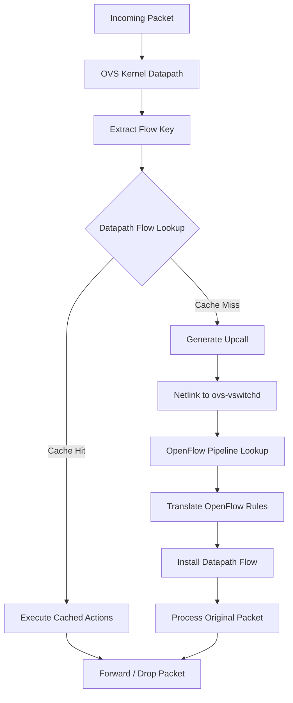
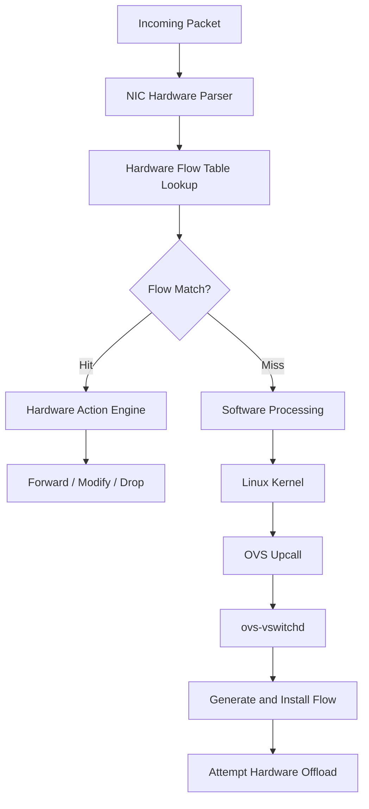
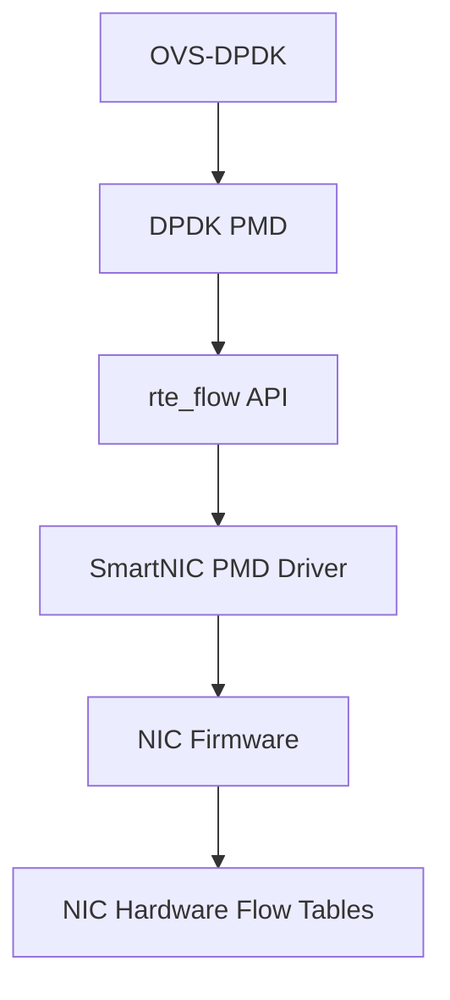
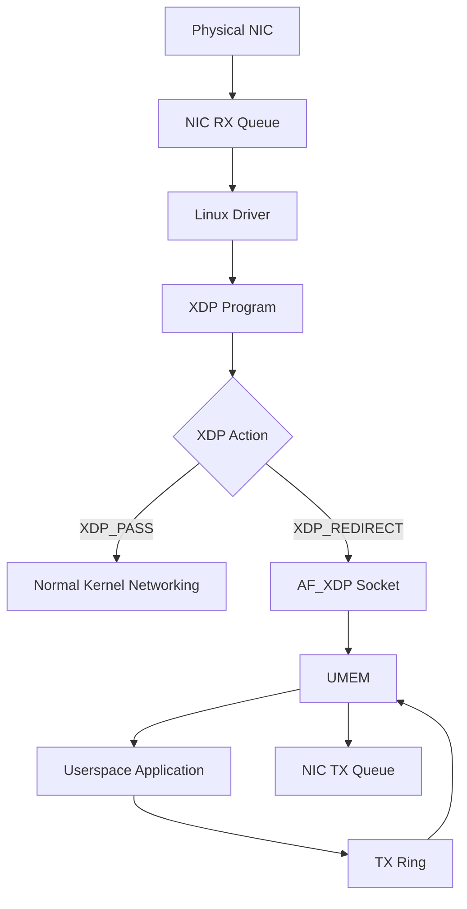
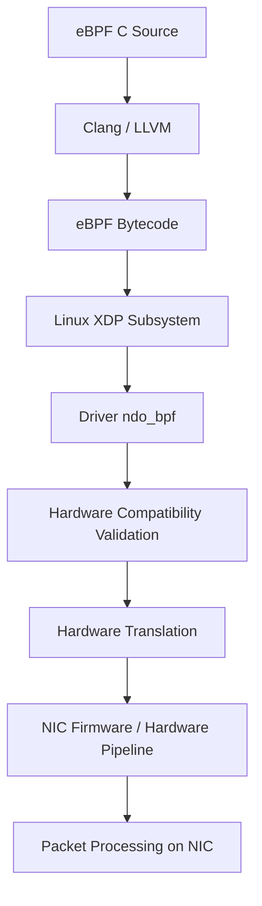

# Open vSwitch Datapath Architecture: Kernel Flow Caching, Hardware Offloading, and SmartNIC Integration


## 1. Introduction

Open vSwitch (OVS) uses a kernel datapath flow table to avoid sending every packet to the userspace ovs-vswitchd daemon for forwarding decisions.

The kernel datapath maintains an in-memory collection of datapath flow entries. Each entry contains:

Flow Key: Identifies packet attributes such as source/destination MAC addresses, IP addresses, TCP/UDP ports, VLAN tags, and ingress port.
Flow Mask: Specifies which packet fields must match and which fields can be wildcarded.
Actions: Defines what the kernel should do with matching packets.

This mechanism acts as a software forwarding cache. It stores the results of userspace packet processing so that subsequent matching packets can be handled directly in the kernel.

### 1.1 Why Does OVS Need a Datapath Cache?

Without datapath flow caching, every incoming packet would potentially require userspace processing by ovs-vswitchd.

This would introduce additional overhead:

Kernel-to-userspace communication.
Netlink upcall processing.
OpenFlow rule lookup.
Userspace packet processing.
Userspace-to-kernel communication.

By caching the forwarding decisions in the kernel, OVS significantly reduces this overhead.

### 1.2 Exact Match and Megaflow Caching

There are two important concepts to understand:

**Exact Match Cache (EMC)**

EMC is a userspace optimization used by certain OVS datapath implementations, particularly the userspace netdev datapath.

It caches exact packet-flow matches to avoid repeatedly performing more expensive flow lookups in userspace.

**Megaflow Cache**

The kernel datapath uses masked flow matching, commonly referred to as megaflow caching.

Instead of requiring every packet-header variation to have a separate entry, a megaflow can match multiple packets using a key and mask.

For example:

```text
Flow Key:
    src_ip  = 10.0.0.1
    dst_ip  = 10.0.0.2
    tcp_dst = 80
    tcp_src = 12345

Flow Mask:
    src_ip  = exact
    dst_ip  = exact
    tcp_dst = exact
    tcp_src = wildcard
```

In this example, packets with different TCP source ports can match the same datapath flow entry.

This reduces the number of flow entries required and improves scalability.

### 1.3 Datapath Actions

Once a packet matches a datapath flow entry, the kernel executes its associated actions without consulting userspace.

Common actions include:
- `output`: Forward the packet to a physical or virtual port.
- `push_vlan/pop_vlan`: Add or remove VLAN tags.
- `set`: Modify packet-header fields, such as MAC or IP addresses.
- `drop`: Discard the packet.
- `userspace`: Send the packet to userspace when required.
- `recirc`: Perform additional processing through a recirculation stage.

The actual actions depend on the OpenFlow rules and the datapath translation performed by OVS.

## 2. OVS Kernel Datapath: Fast Path vs. Slow Path

The OVS datapath processes packets using two main paths.

### 2.1 Fast Path (Cache Hit)

When a packet arrives:

The packet enters the OVS kernel datapath.
The kernel extracts the packet's flow key.
The kernel searches the datapath flow table.
If a matching flow entry exists, the kernel executes its associated actions.
The packet is forwarded without an upcall to ovs-vswitchd.

This is the kernel datapath fast path.

### 2.2 Slow Path (Cache Miss)

When a packet arrives and no matching datapath flow exists:

The packet enters the OVS kernel datapath.
The kernel extracts its flow key.
The kernel searches the datapath flow table.
No matching entry is found.
The kernel generates an upcall to userspace through Netlink.
ovs-vswitchd receives the packet and flow information.
Userspace evaluates the OpenFlow pipeline and determines the required forwarding actions.
OVS installs the resulting datapath flow entry in the kernel.
The packet is handled through the userspace processing path.

Subsequent packets matching the newly installed datapath flow can use the kernel fast path.

### 2.3 Packet Processing Diagram



### 2.4 Where Does the Kernel Perform the Lookup?

The lookup is performed by the OVS kernel datapath itself.

The relevant Linux kernel source directory is:

```text
linux/
└── net/
    └── openvswitch/
        ├── datapath.c
        ├── flow.c
        ├── flow.h
        ├── flow_table.c
        ├── actions.c
        └── vport.c
```

Important components:
| Component | Responsibility |
| :--- | :--- |
|datapath.c | Datapath packet processing and upcall handling |
| flow.c | Flow-key handling and flow-related operations |
| flow_table.c | Kernel datapath flow-table lookup and management |
| flow.h | Flow-related data structures |
| actions.c | Execution of datapath actions |
| ovs-vswitchd |Userspace OpenFlow processing and datapath flow management |

The exact function names and implementation details can vary between kernel and OVS versions.

## 3. Hardware Offloading

### 3.1 What Is Hardware Offloading?

In a standard OVS deployment, the kernel datapath performs packet processing using the server CPU.

Even when a packet hits the kernel datapath cache, the CPU still needs to:

- Process the packet.
- Perform flow lookup.
- Execute the associated actions.
- Forward the packet to the destination interface.

When processing millions of packets per second, this consumes significant CPU resources.

**Hardware offloading moves supported packet-processing operations from the software datapath into the NIC's
hardware processing pipeline.**

Instead of executing the forwarding rules in the Linux kernel, the NIC can execute them directly using its
onboard processing resources.

Examples of hardware platforms include:

- SmartNICs.
- Programmable NICs.
- Network ASICs.
- FPGA-based network adapters.

Hardware offloading is commonly implemented through technologies such as:

- Linux TC Flower hardware offload.
- DPDK rte_flow.
- XDP hardware offload, where supported.

### 3.2 How Hardware Offloading Works

The general process is:

1. First Packet: A new packet arrives and requires flow processing.
2. Rule Generation: OVS userspace determines the forwarding decision.
3. Rule Translation: OVS translates the datapath flow into a hardware-compatible match/action representation.
4. Driver Interaction: The kernel networking subsystem passes the rule to the NIC driver.
5. Hardware Programming: The driver programs the NIC's flow tables.
6. Hardware Forwarding: Subsequent matching packets are processed directly by the NIC.

### 3.3 Hardware Fast Path

Once a flow is successfully offloaded:

- A packet arrives at the physical NIC port.
- The NIC hardware parser extracts the relevant packet-header fields.
- The hardware flow table performs a match.
- The hardware action engine executes the associated actions.
- The packet is forwarded, modified, or dropped directly by the NIC.

The packet no longer needs to traverse the normal Linux kernel software forwarding path for that offloaded processing.



Note: The exact miss-handling behavior depends on the NIC architecture, driver, representor configuration, and offload implementation.

### 3.4 Benefits and Trade-offs

**Benefits**

Higher packet-processing throughput.
Reduced host CPU utilization.
Lower software datapath overhead.
Improved scalability for high packet rates.
More CPU resources available for applications and virtual machines.

**Trade-offs**

- Hardware flow-table capacity is limited.
- Not every OVS datapath action is supported by every NIC.
- Hardware programming and flow synchronization introduce complexity.
- Unsupported rules may remain in software.
- Hardware resources such as TCAM and SRAM are more constrained than system RAM.

Hardware offloading does not automatically guarantee line-rate forwarding. Actual performance depends on the
NIC, its hardware pipeline, supported actions, packet sizes, and workload.

## 4. OVS Hardware Offloading Architecture: TC Flower

For Linux kernel datapath hardware offloading, one of the primary integration mechanisms is Linux Traffic
Control (TC) Flower.

### 4.1 Architecture Overview

In a standard Linux TC Flower offload architecture, OVS uses the Linux networking subsystem to communicate with the NIC driver.

The main components are:

1. ovs-vswitchd: Determines the forwarding rules.
2. Linux TC subsystem: Handles TC Flower rules.
3. NIC driver: Translates generic Linux flow descriptions into hardware-specific commands.
4. firmware/hardware: Programs and executes the flow rules.

OVS does not generally need to communicate directly with the NIC's hardware registers.

Instead, it relies on Linux kernel networking APIs and the driver.

### 4.2 TC Flower Rule Translation Pipeline


### 4.3 How Does the Driver Receive the Offload Request?

The Linux kernel network driver must implement the appropriate TC offload interface.

The primary driver hook is:

```c
.ndo_setup_tc = your_nic_setup_tc
```

When the **TC** subsystem receives a supported hardware-offload request, it can invoke the driver's
**ndo_setup_tc** callback.

For Flower classifier offloading, the driver handles:

```c
TC_SETUP_CLSFLOWER
```

The driver receives a flow_cls_offload structure containing the relevant flow description.

This includes:

- Match keys.
- Match masks.
- Flow actions.
- Flow statistics and lifecycle information.

The driver translates these generic Linux structures into hardware-specific representations.

### 4.4 Driver Responsibilities

The NIC driver must implement the following functionality.

**A. Parse Match Keys and Masks **

Extract the fields that must be matched.

For example:

```text
Source IP      = 10.0.0.1
Destination IP = 10.0.0.2
Destination Port = 80
Protocol       = TCP
```

The driver must also understand which fields are exact matches and which fields are wildcarded.

**B. Parse Actions**

The driver must translate supported Linux flow actions into hardware operations.

Examples include:

- FLOW_ACTION_REDIRECT
- FLOW_ACTION_VLAN_PUSH
- FLOW_ACTION_VLAN_POP
- FLOW_ACTION_MANGLE
- FLOW_ACTION_DROP

Not every action is supported by every hardware platform.

**C. Program Hardware**

The driver communicates with NIC firmware or hardware through mechanisms such as:

- Firmware command interfaces.
- Hardware management queues.
- DMA command rings.
- PCIe register interfaces.

The hardware flow table is updated with the new match/action entry.

**D. Statistics and Flow Lifecycle **

The driver must also support:

- Hardware packet counters.
- Hardware byte counters.
- Flow statistics reporting.
- Flow deletion.
- Flow replacement and updates.
- Hardware resource management.

OVS needs these statistics to manage flow aging and synchronization.

### 4.5 TC Flower Hardware Offload Flags

Linux TC supports several flags related to hardware offloading.

Important examples:

- skip_sw: Do not install a software fallback for the TC rule.
- skip_hw: Do not attempt hardware offloading.
- in_hw: Indicates that a rule has been successfully installed in hardware in the relevant TC interfaces.

These flags have different meanings. In particular, in_hw is generally a reported status rather than a
request to force hardware installation.

The actual flags used depend on the OVS and kernel implementation.

### 4.6 What Happens When Hardware Does Not Support a Rule?

Suppose OVS generates a flow containing an action that the NIC does not support.

For example, the NIC might support:

- IPv4 and IPv6 matching.
- VLAN push/pop.
- Basic packet redirection.

But it might not support a particular encapsulation or complex packet rewrite.

In this case, the hardware offload attempt may fail.

Depending on the configuration and offload policy, OVS can retain or install the corresponding software datapath processing instead.

This is why driver feature coverage is critical for successful hardware offloading.

--- 

## 5. Enabling and Verifying OVS Hardware Offloading

### 5.1 Enable Hardware Offloading in OVS

Enable the hardware-offload configuration:

```bash
sudo ovs-vsctl set Open_vSwitch . other_config:hw-offload=true
```

For a conventional OVS deployment, restart ovs-vswitchd or the relevant OVS service to apply the configuration.

For example:

```bash
sudo systemctl restart openvswitch-switch
```

The service name can vary by Linux distribution.

### 5.2 Enable TC Hardware Offloading on the NIC

The NIC driver must support TC hardware offloading.

Enable the relevant feature:

```bash
sudo ethtool -K eth0 hw-tc-offload on
```

Verify the setting:

```bash
sudo ethtool -k eth0 | grep hw-tc-offload
```

Expected output:

```text
hw-tc-offload: on
```

The interface must also be configured appropriately for the chosen OVS offload architecture.

### 5.3 Verify Hardware-Offloaded Flows

Use:

```bash
sudo ovs-appctl dpctl/dump-flows -m
```

This displays datapath flows with additional metadata.

Look for the hardware-offload status:

**Successfully Offloaded Flow**

```text
recirc_id(0),in_port(2),eth_type(0x0800),
packets:1042, bytes:15124,
used:0.010s, actions:3, offloaded:yes
```

**Software Datapath Flow**

```text
recirc_id(0),in_port(2),eth_type(0x0800),
packets:25, bytes:2100,
used:0.420s, actions:3, offloaded:no
```

The exact output format depends on the OVS version and datapath implementation.

The important field is:

```text
offloaded:yes
```

This indicates that the flow has been successfully offloaded according to the OVS datapath reporting mechanism.

## 5.4 Count Hardware-Offloaded Flows

To count flows reporting successful hardware offload:

```bash
sudo ovs-appctl dpctl/dump-flows -m | grep -c "offloaded:yes"
```

This counts the reported offloaded flow entries, not the number of packets processed in hardware.

## 6. Requirements for Developing a SmartNIC That Supports OVS Hardware Offloading

To support OVS hardware offloading, a SmartNIC requires three major components:

1. Hardware packet-processing architecture.
2. Firmware and hardware-management interfaces.
3. Linux network driver integration.

The standard Linux kernel datapath offload architecture relies heavily on the TC Flower subsystem.

### 6.1 Hardware Architecture Requirements

The SmartNIC must be capable of parsing packets, matching flow entries, and executing forwarding actions
without requiring host CPU involvement for every packet.

**A. Programmable Packet Parser and Pipeline **

The hardware must support parsing relevant networking headers, including:

- Ethernet (L2).
- VLAN.
- IPv4 and IPv6 (L3).
- TCP and UDP (L4).

Tunnel encapsulations such as VXLAN, Geneve, and NVGRE, where required.

The parser must operate at the target interface's required packet rate.

**B. Hardware Flow Tables **

The hardware needs memory structures to store flow entries.

Common implementations include:

- TCAM: Supports masked and wildcard matching.
- SRAM: Supports fast exact-match tables and other lookup structures.
- Specialized lookup engines: Used for scalable flow classification.

A megaflow-style rule requires hardware support for the corresponding key/mask matching semantics.

**C. Hardware Action Engine**

The SmartNIC must support the actions required by the target OVS deployment.

Examples:

- Packet forwarding.
- VLAN push/pop.
- MAC address rewrite.
- IP address rewrite.
- Packet drop.
- Packet mirroring.
- Tunnel encapsulation/decapsulation, where supported.
- Packet and byte counters.

The supported action set depends on the hardware pipeline.

**D. Flow Resource Management **

The hardware architecture must also manage:

- Flow-table capacity.
- TCAM/SRAM allocation.
- Flow insertion and deletion.
- Counter allocation.
- Aging.
- Hardware resource exhaustion.

### 6.2 Software Driver Layer: Linux Upstream Model

The Linux network driver is responsible for connecting the TC subsystem to the SmartNIC hardware.

The architecture is:

```text
[ ovs-vswitchd ]
       |
       | TC Flower Netlink
       v
[ Linux Kernel TC Subsystem ]
       |
       | ndo_setup_tc()
       v
[ SmartNIC Linux Driver ]
       |
       | Firmware Commands
       v
[ SmartNIC Firmware ]
       |
       v
[ SmartNIC Hardware ]
```

**A. Implement the ndo_setup_tc Hook**

The driver's net_device_ops structure must provide the relevant callback:

```c
static const struct net_device_ops your_nic_netdev_ops = {
    .ndo_setup_tc = your_nic_setup_tc,
};
```

This callback allows the driver to receive supported TC offload setup requests.

**B. Handle TC_SETUP_CLSFLOWER**

Inside the driver's TC setup implementation, handle the Flower classifier setup request.

Conceptually:

```c
static int your_nic_setup_tc(struct net_device *dev,
                             enum tc_setup_type type,
                             void *type_data)
{
    switch (type) {
    case TC_SETUP_CLSFLOWER:
        return your_nic_setup_flower(dev, type_data);

    default:
        return -EOPNOTSUPP;
    }
}
```

This is illustrative code. The exact callback signature and required handling depend on the target kernel
version and driver architecture.

The Flower handler must:

1. Parse the flow_cls_offload structure.
2. Extract the match keys.
3. Extract the match masks.
4. Parse the action list.
5. Validate hardware support.
6. Allocate hardware flow resources.
7. Program the NIC hardware.
8. Return appropriate success or error status.


**C. Statistics Feedback**

The driver must provide hardware statistics to the Linux networking subsystem.

OVS relies on these statistics for flow management.

For example:

```text
Hardware Flow Entry
       |
       v
Packet Counter
Byte Counter
       |
       v
Driver Statistics Query
       |
       v
Linux TC Subsystem
       |
       v
OVS Flow Statistics
```

The implementation must also handle flow deletion, replacement, and resource cleanup.

## 7. Alternative Hardware Offload Architecture: DPDK and RTE Flow

Another approach is to use OVS-DPDK instead of the standard Linux kernel datapath.

### 7.1 OVS-DPDK Architecture

OVS-DPDK uses a userspace datapath and DPDK Poll Mode Drivers (PMDs).

Instead of relying on the Linux kernel's TC Flower subsystem, OVS-DPDK can use the DPDK rte_flow API to configure hardware flow rules.

The architecture looks like this:



### 7.2 RTE Flow Integration

The rte_flow API provides a standardized interface for configuring hardware flow rules.

It supports three main concepts:

Attributes: Define the flow domain and priority.
Pattern: Defines the packet fields to match.
Actions: Defines what to do with matching packets.

Conceptually:

```c
struct rte_flow_attr attr;

struct rte_flow_item pattern[] = {
    /* Ethernet, IPv4, TCP matching */
    { .type = RTE_FLOW_ITEM_TYPE_END }
};

struct rte_flow_action actions[] = {
    /* Forwarding or other supported actions */
    { .type = RTE_FLOW_ACTION_TYPE_END }
};

struct rte_flow *flow;

flow = rte_flow_create(port_id,
                       &attr,
                       pattern,
                       actions,
                       &error);
```

This is illustrative code; actual patterns, actions, and validation depend on the PMD and NIC capabilities.

### 7.3 Driver Requirements

For OVS-DPDK hardware offloading, the SmartNIC vendor must provide a compatible DPDK PMD.

The PMD must implement the relevant rte_flow operations and translate them into hardware commands.

The hardware must support the required packet matching and action capabilities.

**Important distinction**:

TC Flower and DPDK RTE Flow are different integration paths.

| Feature | TC Flower | DPDK RTE Flow |
| :--- | :--- | :--- |
| Main interface | Linux TC subsystem | DPDK API |
| Driver integration | Linux kernel NIC driver | DPDK PMD |
| Primary API | `ndo_setup_tc`/`Flower` | `rte_flow` |
| Control plane | Linux networking subsystem | Userspace DPDK |
| Typical datapath | OVS kernel datapath | OVS-DPDK |


## 8. Alternative Packet I/O Architecture: AF_XDP

`AF_XDP` is another Linux networking technology used for high-performance packet I/O.

However, it is important to distinguish AF_XDP from hardware flow offloading.

AF_XDP is primarily a mechanism for efficiently transferring packets between the NIC driver/kernel
networking stack and userspace. It does not automatically offload OVS forwarding rules into NIC hardware.

### 8.1 Where AF_XDP Fits in the Datapath Spectrum

There are several packet-processing architectures:

**Standard OVS Kernel Datapath**

- Packet processing occurs in the Linux kernel.
- Uses kernel sk_buff packet buffers.
- Uses the kernel datapath flow table.
- Can use TC Flower for hardware flow offloading.

**OVS-DPDK**

- Packet processing occurs in userspace.
- Uses DPDK packet buffers and PMDs.
- Can use DPDK rte_flow for hardware flow offloading.
- Commonly uses dedicated CPU cores for polling.

**OVS with AF_XDP**

- Uses AF_XDP sockets for packet I/O between the NIC driver and userspace.
- Uses UMEM for packet-buffer management.
- Can support zero-copy operation when the driver and hardware support it.
- Retains the Linux kernel control plane and networking infrastructure.

### 8.2 AF_XDP Architecture

AF_XDP uses several important components:

- XDP program.
- XSK (AF_XDP socket).
- UMEM.
- RX and TX rings.
- Fill and completion rings.

The packet flow is approximately:



When an XDP program returns XDP_REDIRECT toward an AF_XDP socket, the packet is redirected to the socket
associated with the selected XSK.

The application accesses packet buffers through UMEM.

In zero-copy mode, the NIC driver can use UMEM-backed buffers directly, avoiding an additional packet-data copy.

In copy mode, packet data is copied between the kernel networking buffers and UMEM.

### 8.3 How Hardware Offloading Relates to AF_XDP

There is a separate technology called XDP hardware offload.

With XDP hardware offload, the NIC can execute a supported XDP program directly in its hardware processing pipeline.

This is different from normal AF_XDP operation.

The two technologies can be understood as follows:

| Technology | Main purpose |
| :--- | :--- | 
| AF_XDP | Efficient packet transfer between kernel/driver and userspace |
| XDP | Programmable packet processing in the kernel driver path |
| XDP Hardware Offload | Execute supported XDP programs on NIC hardware |

### 8.4 SmartNIC Driver Requirements for AF_XDP

To support high-performance AF_XDP packet I/O, the SmartNIC driver needs to support the AF_XDP socket infrastructure.

Important requirements include:

**A. Zero-Copy Support**

The driver must support AF_XDP zero-copy mode if zero-copy performance is required.

This involves integrating the XSK buffer pool with the NIC's RX/TX descriptor management and DMA operations.

The driver must correctly manage:

- UMEM-backed buffers.
- RX descriptors.
- TX descriptors.
- Fill ring.
- Completion ring.
- Buffer ownership and recycling.

**B. XDP Driver Support**

The driver must implement the appropriate XDP program attachment and management interfaces.

The relevant network device operation is:

```c
static const struct net_device_ops your_nic_netdev_ops = {
    .ndo_bpf = your_nic_ndo_bpf,
};
```

The driver handles supported XDP program setup operations and validates the program against the capabilities of its execution environment.

**C. XDP Hardware Offload Support (Optional)**

If the SmartNIC is expected to execute XDP programs directly in hardware, it must support XDP hardware offload.

The driver and hardware must provide the required program validation, translation, and hardware-programming mechanisms.

Not all eBPF instructions, helpers, maps, or program features are necessarily supported by a NIC.

A hardware implementation may support only a restricted subset of XDP functionality.

### 8.5 XDP Hardware Offload Architecture



This diagram represents the optional XDP hardware-offload path, not the normal AF_XDP zero-copy path.

### 8.6 AF_XDP vs. TC Flower vs. DPDK RTE Flow

These technologies solve different problems.

| Requirement | TC Flower | DPDK RTE Flow | AF_XDP / XDP |
| :--- | :--- | :--- | :--- | 
| Primary purpose | Hardware match/action offload | Hardware match/action offload | High-performance packet I/O and programmable packet processing |
| Main interface | Linux TC | DPDK API | Linux XDP / AF_XDP |
| Driver integration | `ndo_setup_tc` | DPDK PMD | `ndo_bpf` and `AF_XDP` driver support |
| Hardware representation | Match/action flow entries | Match/action flow entries | XDP program execution, if hardware offload is supported |
| Packet I/O | Kernel networking | Userspace PMD | UMEM and AF_XDP rings |
| Zero-copy | Not its primary purpose | Supported by suitable PMDs and configurations | Supported by suitable NIC drivers |
| Flexibility | Limited to supported TC matches/actions | Limited to supported RTE Flow patterns/actions | Depends on XDP program and hardware support | 

## 9. Summary: SmartNIC Development Requirements

To develop a SmartNIC that supports OVS hardware offloading, the required architecture depends on the target OVS datapath.

### 9.1 TC Flower-Based SmartNIC

For standard OVS kernel datapath hardware offloading:

1. Silicon / FPGA

- Programmable packet parser.
- Hardware match/action pipeline.
- TCAM/SRAM or equivalent flow-table resources.
- Packet modification and forwarding engine.
- Hardware packet/byte counters.

2. Firmware

- Hardware flow insertion and deletion.
- Flow-table resource management.
- Statistics reporting.
- Error handling and synchronization.

3. Linux Kernel Driver

- TC Flower offload integration.
- ndo_setup_tc implementation.
- TC_SETUP_CLSFLOWER support.
- Match/mask parsing.
- Action translation.
- Statistics and flow lifecycle management.

4. Validation

- ethtool -K eth0 hw-tc-offload on.
- OVS hardware-offload configuration.
- Verification through ovs-appctl dpctl/dump-flows -m.
- Testing supported and unsupported actions.
- Testing flow insertion, deletion, aging, and counter updates.

### 9.2 DPDK-Based SmartNIC

For OVS-DPDK hardware offloading:

1. Hardware match/action pipeline.
2. Firmware flow-management interfaces.
3. DPDK PMD implementation.
4. rte_flow support.
5. Hardware flow statistics and lifecycle management.

### 9.3 AF_XDP-Based SmartNIC

For high-performance AF_XDP packet I/O:

1. XDP driver support.
2. AF_XDP socket integration.
3. UMEM buffer management.
4. RX/TX ring integration.
5. Zero-copy support, if required.
6.   Optional XDP hardware offload support, if the NIC is expected to execute XDP programs directly.

### 9.4 Final Architecture Comparison

| Architecture | OVS Datapath | Primary Driver Interface | Hardware Offload Mechanism |
| :--- | :--- | :--- | :--- |
| Standard OVS | Linux kernel | Linux netdev driver	| TC Flower |
| OVS-DPDK | Userspace | DPDK PMD | RTE Flow |
| OVS with AF_XDP | Userspace packet I/O using AF_XDP | Linux netdev/XDP driver	| Optional XDP hardware offload |


**Final takeaway**:

For a SmartNIC targeting standard Linux OVS kernel datapath hardware offloading, the most important
integration requirement is support for Linux TC Flower through ndo_setup_tc.

For a SmartNIC targeting OVS-DPDK, the corresponding requirement is a DPDK PMD with rte_flow support.

For a SmartNIC targeting AF_XDP, the primary requirements are XDP driver integration, AF_XDP socket support,
and efficient UMEM-based packet I/O. XDP hardware offload is an additional, separate capability.

These are different networking architectures, and a SmartNIC may support one or multiple paths depending on
its hardware pipeline, firmware, and driver design.
