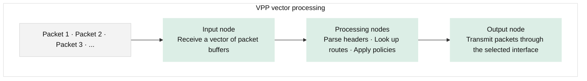
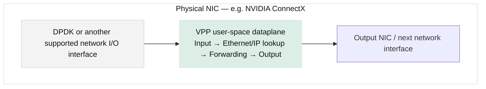
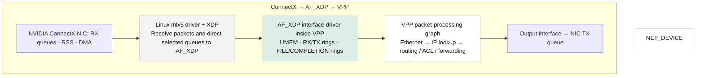

# VPP: vector pkt processing .


## Intro: (VPP: Vector packet processing)

- High performance networking framework that processes network pkts in batches, or **vectors** rather than
  processing each packet individually.

  Traditional network stacks process pkts in scalar-style ( one pkt at a time ). VPP processes pkts in
  **batches (vectors)**, by processing a vector of packets through a set of operations, instructions stay
  warm in the CPU's cache, which drastically reduces cache misses and overhead. 

- VPP is an open-source project originally developed by Cisco and now maintained by the Linux Foundation's 
  `FD.io` project. VPP is commonly used to build high-speed software routers, virtual switches, firewalls, 
  and other network functions.

- The key idea is to improve packet-processing throughput by making better use of CPU caches,
  instruction-level parallelism, and efficient processing pipelines.

### 1. The core idea: process packets in batches

Consider a traditional packet-processing path in which each packet is handled separately.

```text 
    Traditional packet processing
    
    Packet 1 → Process → Forward

    Packet 2 → Process → Forward

    Packet 3 → Process → Forward
```

Repeated processing steps can add overhead and reduce opportunities for efficient CPU execution.

VPP instead collects multiple packets and processes them through a sequence of optimized processing stages.




The term vector here means a collection of packet-buffer references processed together. It does not
necessarily mean SIMD vector instructions, although VPP can also use CPU vector instructions where
appropriate.

### 2. Why is VPP faster?

VPP's performance comes from several techniques, not just batching.

- Batch processing: Amortizes the cost of dispatching processing functions across multiple packets.

- CPU cache efficiency: Reuses instructions and data while processing packets through the same node.

- Prefetching and pipelining: Loads packet data and lookup information ahead of when they are needed.

- Graph-based processing: Keeps individual processing stages modular and reduces deep function-call chains.

- Multicore processing: Worker threads can process traffic from multiple NIC queues in parallel.&#x20;

  [The Vector Packet Processor 20.01 documentation](https://fdio-vpp.readthedocs.io/en/latest/overview/whatisvpp/what-is-vector-packet-processing.html)

## 3. Where does VPP fit in a networking stack?



VPP runs its networking data-plane in user-space. It can use DPDK for high-performance NIC I/O, although DPDK
is not the same thing as VPP itself. VPP provides the packet-processing framework and networking functions;
DPDK can provide the fast path to the NIC.&#x20;

 [fd.io](fd.io)

### 4. VPP vs. DPDK vs. AF_XDP

Since these technologies all relate to high-performance packet processing, it helps to distinguish their roles.

| Technology | Primary role                                                                                                             |
| ---------- | ------------------------------------------------------------------------------------------------------------------------ |
| VPP        | A complete, graph-based packet-processing framework with routing, switching, and other networking functions              |
| DPDK       | A user-space packet I/O and processing toolkit with poll-mode drivers and packet-buffer facilities                        |
| `AF_XDP`     | A Linux socket interface that lets user-space applications receive and transmit packets through XDP, using UMEM and rings |
| eBPF/XDP   | Runs programmable packet-processing logic in the Linux kernel, often very early in the receive path                      |

These technologies are not direct equivalents. VPP can use DPDK, while `AF_XDP` is an alternative way for a
user-space application to interact with packets through the Linux networking stack.

### 5. When would you use VPP?

Typical applications include:

- High-throughput software routers and virtual switches.
- Network-function virtualization (NFV).
- Software gateways, firewalls, and load balancers.
- Packet-processing pipelines that need custom plugins.

The official [FD.io VPP documentation](https://docs.fd.io/vpp/25.02/) describes its architecture and
supported use cases.&#x20;

[docs.fd.io](docs.fd.io)

In short: VPP is a software networking data-plane that improves packet-processing efficiency by processing
batches of packets through an optimized graph of processing stages.

------------------------------------------------------------------------------------

# ( FD.io ) VPP  handles  `AF_XDP` 

FD.io:VPP fits with `AF_XDP` as a user-space pkt-processing engine that can use `AF_XDP` as its NIC I/O
interface.

The important distinction is that `AF_XDP` provides the mechanism for exchanging packets between a NIC and
user-space, while VPP provides the packet-processing framework that decides what to do with those packets.
VPP has an `AF_XDP` interface driver for this purpose.&#x20;

[+1 docs.fs.io](docs.fd.io)

## 1. Architecture: ConnectX → AF_XDP → VPP




In this design, VPP owns the `AF_XDP` sockets it creates through its interface driver and processes received
packets in batches through its graph. Your application normally configures and monitors VPP through its CLI
or API rather than implementing the `AF_XDP` rings itself.

## 2. Two ways to use AF_XDP

There are two architectures worth distinguishing.

[VPP Technology](https://images.openai.com/static-rsc-4/XeBfqwkcBcWQKTenLWcWW7E21DCkOVedWfDzm7ZG109QcSSiZ2uhxBMMPB6M9-0gKpuy6UQ5dAjq3ZFOuHyMPj4x2QCNAr6bRLTmJ6nKeUpor9BlPEELg_zoBgbkenaIVwWPJoTAmB1YMkgDcql-FGL6vbgVH1DspLwu82KoElU?purpose=inline)

**Option A**:  VPP owns the `AF_XDP` sockets

VPP creates the sockets, manages the rings and buffers, and passes packets through its own processing graph.

- You configure routing, switching, and interfaces through VPP.
- You do not need to implement the `AF_XDP` receive/transmit loop yourself.
- VPP documents this as its `AF_XDP` device driver.&#x20;

 [docs.fd.io](docs.fd.io)

[AF_XDP - NgKore Documentation](https://images.openai.com/static-rsc-4/C3BATtj7unjAYIvdK5NLBNvCEW8L2iwTe5_3e3ZAFsBqVNtv5qc2T6yywS7RO3mA-0w15vTzD_VuL-E7Zy-HcpwJPkFaXrUU40ZrVaKlRonMpjTMXot83PLuU3hSVDD9wM-8Gn9jIU-8tZB-nAZbhyctWiqRPWbwOOaYwtxntBg?purpose=inline)

**Option B**: Your application owns the `AF_XDP` sockets

Your Rust application uses `AF_XDP` directly, potentially with `xsk-rs`, while your Aya eBPF program
redirects selected packets into its XSKMAP.

- You implement your own packet-processing logic.
- You manage `UMEM`, `RX/TX` rings, queue mappings, and packet statistics.
- VPP is not required unless you want to integrate it as a separate networking data-plane.

Important: These are alternative ways to own the `AF_XDP` data path for a given queue. Do not assume your
Rust application and VPP can independently consume the same RX queue at the same time.

## 3. How this relates with Aya + `xsk-rs` project

Your existing project, `afxdp-icmp-rs`, is closer to Option B:
```text 
    ConnectX NIC → Linux mlx5 driver => 
                        Aya eBPF/XDP program =>
                            Identify ICMP packets → redirect via XSKMAP => 
                                Rust user-space + xsk-rs => 
                                   AF_XDP socket → receive packets → increment/report counters
```                                

Your application defines what happens to the packets after receiving them.

If you switch to VPP, you would generally let VPP's `AF_XDP` driver manage the sockets and use VPP's
existing graph nodes or a custom VPP plugin for additional processing. Your current Aya + `xsk-rs`
implementation would no longer be the owner of those same sockets.

## 4. Is VPP worth exploring on ConnectX-7?

Yes, especially if your goal is to compare high-performance software data-planes. 
VPP's `AF_XDP` driver supports copy and zero-copy modes, multiple queues, and custom XDP programs, but the 
official documentation still describes the driver as under development and notes limitations around MTU, 
buffers, and queue configuration.&#x20;

[docs.fd.io](docs.fd.io)

For a useful experiment, compare:

| Experiment     | What you measure                                          |
| -------------- | --------------------------------------------------------- |
| Aya + `xsk-rs` | Custom `AF_XDP` application throughput and packet rate      |
| VPP + `AF_XDP`   | Throughput and packet rate through VPP's processing graph |
| VPP + DPDK     | Performance using VPP's DPDK-based NIC I/O path           |

Keep the NIC, traffic pattern, MTU, queue count, CPU affinity, and offloads as consistent as possible. Also
verify zero-copy operation rather than assuming that selecting `AF_XDP` guarantees it.

My recommendation: Continue with Aya + `xsk-rs` if your primary goal is learning `AF_XDP` internals. Explore
VPP's `AF_XDP` driver when you want to compare a custom packet-processing application against a complete
user-space networking stack.

--------------------------------------------------------------------------

# Run FD.io VPP on Fedora with AF_XDP 

To run **FD.io VPP with AF_XDP** on **Fedora 43**, you will use VPP's native AF_XDP plugin. 

Because AF_XDP bridges user-space with the Linux kernel's eBPF subsystem, setup requires preparing both 
Fedora host system packages and the network interface configurations.

---

### Step 1: Install Required Packages on Fedora 43

VPP for Fedora is typically distributed via community Copr repositories or official FD.io RPM channels.

1. **Enable the Copr repository for VPP** (or your preferred release source):
```bash
sudo dnf copr enable nucleo/vpp-25.10

```


2. **Install VPP and its plugins:**
```bash
sudo dnf install vpp vpp-plugins vpp-api-python3

```


* `vpp`: The core vector packet processing daemon and command-line utilities (`vppctl`).
* `vpp-plugins`: Required because the `af_xdp` driver ships as a modular plugin inside this package.


---

### Step 2: Prepare the Host Network Interface

Unlike DPDK (which unbinds the card from Linux completely), AF_XDP interacts with an active Linux network interface. Before pointing VPP to it, configure the host interface:

1. **Identify your network interface name** (e.g., `enp1s0f0`):
```bash
ip link

```


2. **Ensure the interface has multiple queues configured** (AF_XDP performs best when mapped explicitly to specific RX/TX queues):
```bash
sudo ethtool -L enp1s0f0 combined 4

```


3. **Set the interface up and enable promiscuous mode** so it captures all incoming traffic flows:
```bash
sudo ip link set dev enp1s0f0 promisc on up

```


---

### Step 3: Start VPP

Start and enable the VPP service via systemd:

```bash
sudo systemctl enable --now vpp

```

Verify that VPP is running and you can access its command shell:

```bash
sudo vppctl

```

*(Once inside the `vpp#` prompt, you can type `show version` to verify the installation).*

---

### Step 4: Create and Bind the AF_XDP Interface in VPP

Inside the `vppctl` interactive terminal, instruct VPP to hook into the host interface using the AF_XDP driver:

```text
vpp# create int af_xdp host-if enp1s0f0 num-rx-queues 4

```

*Note: Depending on your kernel and NIC driver capabilities, VPP will automatically attempt to negotiate **zero-copy mode** with the kernel for maximum throughput. If the driver doesn't support zero-copy, it will gracefully fall back to copy mode.*

### Step 5: Configure IP and Bring Interface Up

Just like a normal network interface, assign it an IP address and turn it on within VPP:

```text
vpp# set int ip address af_xdp0 192.168.1.10/24
vpp# set int state af_xdp0 up

```

You can now test connectivity or routing using standard VPP commands:

```text
vpp# ping 192.168.1.1

```
-------------------------------------------------------------------------O
# Using FD.io VPP with AF_XDP on Fedora 43

To run FD.io VPP as a user-space networking data-plane, using `AF_XDP` to receive and transmit packets 
through a NIC's Linux driver.

VPP handles packet processing—such as Ethernet input, IP routing, and forwarding—while its AF_XDP interface 
driver handles the AF_XDP sockets and packet rings.

## 1. Architecture

```text 

                Physical NIC

    Intel i350 or another supported NIC

        Linux kernel network driver

    XDP program + AF_XDP socket support

        VPP AF_XDP interface driver

    RX/TX · UMEM · FILL/COMPLETION rings

        VPP processing graph

    Ethernet → IP lookup → routing → output
```

You do not need to write a Rust application to use VPP. VPP is primarily a C-based networking framework with a CLI, configuration facilities, and APIs. Rust is optional if you later want a separate application or management client.

## 2. Required host packages on Fedora 43

For a source build, start with these Fedora development tools and libraries. Exact dependencies can vary with the VPP release and enabled plugins.

```
sudo dnf install -y \
    git gcc gcc-c++ make cmake ninja-build \
    python3 python3-devel python3-pip \
    autoconf automake libtool bison flex \
    pkgconf-pkg-config \
    numactl-devel libpcap-devel \
    openssl-devel libelf-devel libbpf-devel \
    clang llvm \
    zlib-devel libuuid-devel \
    libnl3-devel rpm-build
```

Useful runtime and diagnostic tools:

```
sudo dnf install -y \
    iproute ethtool iperf3 tcpdump \
    pciutils numactl
```

These packages provide the compiler/build environment, packet-capture and networking tools, and libraries relevant to VPP and AF_XDP. The list is a starting point, not a guaranteed complete dependency manifest for every VPP release.

Important: FD.io's published binary-package instructions primarily cover Debian/Ubuntu, and its source-build instructions document RPM packaging. Do not assume an official prebuilt RPM will work on Fedora 43 without checking the target release. For Fedora, building from source is a reasonable route.&#x20;

[image](https://www.google.com/s2/favicons?domain=https://docs.fd.io\&sz=32)

docs.fd.io

+2


## 3. Build and install VPP

Clone the official source repository:

```
git clone https://gerrit.fd.io/r/vpp
cd vpp
```

Check the available build targets and the current branch's build instructions:

```
make help
```

FD.io documents `make build-release` and RPM packaging targets, but dependency-installation scripts can be distribution-specific. On Fedora, resolve any missing build dependencies with `dnf` rather than assuming Ubuntu-specific commands will work.&#x20;

[image](https://www.google.com/s2/favicons?domain=https://fdio-vpp.readthedocs.io\&sz=32)

Vector Packet Processor 01 documentation

+1


For an RPM build, the documented target is:

```
make pkg-rpm
```

Inspect the resulting packages under `build-root/` before installing them. The exact artifact paths and package names can vary by branch and build configuration.

Before proceeding, confirm that your VPP build includes the AF_XDP plugin. The presence of the `af_xdp` CLI commands is the practical check.

## 4. Configure an AF_XDP interface in VPP

First, identify the NIC interface name:

```
ip -br link
ethtool -i enp3s0
ethtool -l enp3s0
```

Replace `enp3s0` with your actual interface name.

Before proceeding, use a NIC port that is not carrying your SSH connection or essential host traffic. VPP will take ownership of packets from the RX queues selected for its AF_XDP interface.

### Step A — Prepare the Linux interface

```
sudo ip link set dev enp3s0 up
sudo ip link set dev enp3s0 promisc on
```

Ensure that the NIC has enough RX queues configured for your intended VPP configuration. AF_XDP queue ownership matters: VPP will consume packets arriving on the queues assigned to its sockets.&#x20;

[image](https://www.google.com/s2/favicons?domain=https://s3-docs.fd.io\&sz=32)

s3-docs.fd.io

+1


### Step B — Start VPP

After installing the built RPM packages, start the service if the package provides the corresponding systemd unit:

```
sudo systemctl enable --now vpp
sudo vppctl show version
sudo vppctl show plugins
```

Check that the AF_XDP plugin is available. If the plugin is not loaded, check your VPP build and `/etc/vpp/startup.conf`.

### Step C — Create the AF_XDP interface

The VPP 25.02 CLI documents the following command syntax.&#x20;

[image](https://www.google.com/s2/favicons?domain=https://docs.fd.io\&sz=32)

docs.fd.io


```
sudo vppctl
```

Then, at the VPP CLI prompt:

```
create interface af_xdp enp3s0 num-rx-queues all zero-copy
show interface
```

This requests a zero-copy AF_XDP interface using all available RX queues. The NIC must support the required zero-copy operation for those queues; otherwise, interface creation may fail.

For an initial compatibility test, omit `zero-copy` and test the default mode first if necessary.

### Step D — Configure an IP address

For example, assign a test address to the VPP interface:

```
set interface ip address af_xdp0 192.168.100.1/24
set interface state af_xdp0 up
show interface
show errors
show runtime
```

Confirm the actual interface name with `show interface`; do not assume it is `af_xdp0` if VPP assigned a different name.

The Linux interface and VPP interface are not interchangeable: configure the test IP on the VPP interface, and avoid assigning the same IP address to both.

## 5. What about Rust?

Rust is optional. You can configure and run VPP entirely through its CLI and API.

If you later need Rust, a Rust program can act as a VPP API client to configure interfaces, query counters, or automate tests. VPP itself remains responsible for packet I/O and forwarding.

## 6. Official references

- [VPP AF_XDP CLI reference](https://docs.fd.io/vpp/25.02/cli-reference/clis/clicmd_src_plugins_af_xdp.html)
- [VPP AF_XDP driver documentation](https://docs.fd.io/vpp/22.10/developer/devicedrivers/af_xdp.html)
- [FD.io VPP build and installation guide](https://wiki.fd.io/view/VPP/Build,_install,_and_test_images)

Recommended first milestone: build VPP with the AF_XDP plugin, create one interface in zero-copy mode, confirm it appears in `show interface`, and then validate packet reception and transmission with a second machine.
